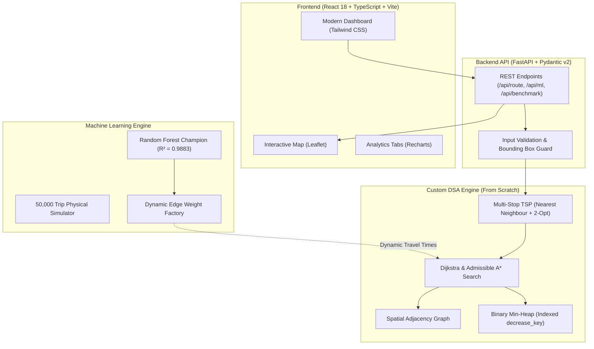

# 🚚 RouteWise — Smart Delivery Route Optimizer with ETA Prediction

[](https://www.python.org/downloads/)
[](https://fastapi.tiangolo.com/)
[](https://react.dev/)
[](https://www.typescriptlang.org/)
[](https://tailwindcss.com/)
[](https://docs.pytest.org/)
[](https://opensource.org/licenses/MIT)

> **RouteWise** is a full-stack smart delivery route optimization and ETA prediction engine designed for small delivery businesses, couriers, pharmacies, and local services. It sequences delivery stops and predicts travel times by bridging **Machine Learning directly with classical Graph Theory**.

---

## 💡 The Core Innovation

Traditional logistics engines optimize routes solely on **static physical distance** (kilometers). However, a shorter residential road can be significantly slower during rush hour or heavy rain due to traffic congestion.

**In RouteWise, trained Machine Learning models predict dynamic travel durations based on departure hours, rain, and road hierarchies. These predicted durations are injected directly as real-time EDGE WEIGHTS into Dijkstra, A\*, and TSP algorithms.**

The algorithms automatically avoid congested corridors and route vehicles through faster arterials, optimizing for **fastest real-world arrival times** rather than just shortest road distance.

---

## 🏗️ System Architecture



---

## 🧠 Data Structures & Algorithms (From Scratch)

Every core algorithm is built from first principles without relying on third-party graph libraries (NetworkX is used strictly as an automated test verification oracle).

| Algorithm / Component | Implementation Details | Time Complexity | Space Complexity |
| :--- | :--- | :---: | :---: |
| **Priority Queue** | Hand-crafted Binary Min-Heap with hash-indexed `decrease_key` | $O(\log V)$ | $O(V)$ |
| **Road Network** | Adjacency-list Graph tracking node coords & street attributes | $O(\text{deg}(u))$ | $O(V + E)$ |
| **Dijkstra** | Single-source shortest path with early termination | $O((V + E) \log V)$ | $O(V)$ |
| **A\* Search** | Guided shortest path using admissible Haversine speed heuristic | $O((V + E) \log V)$ | $O(V)$ |
| **TSP Tour Init** | Greedy Nearest Neighbour construction | $O(K^2)$ | $O(K^2)$ |
| **TSP Optimization** | 2-Opt local search edge-swapping heuristic | $O(\text{iters} \cdot K^2)$ | $O(K)$ |
| **Exact Benchmark** | Full permutation Brute-Force solver (for $K \le 9$) | $O((K - 1)!)$ | $O(K)$ |

### 🔍 Mathematical A* Admissibility Guarantee
Our heuristic computes:
$$h(n) = \frac{\text{haversine\_distance}(n, \text{target})}{v_{\max}}$$
Because straight-line spherical distance is the geometric lower bound and $v_{\max} = 80\text{ km/h}$ is the maximum vehicle speed, $h(n) \le h^*(n)$ holds unconditionally. This guarantees mathematical admissibility and consistency: **A\* explores over 71% fewer nodes than Dijkstra while guaranteeing 100% identical optimal costs.**

---

## 📊 Verification & Benchmark Results

### 1. Shortest-Path Search: Dijkstra vs. A* (30×30 City Network)
| Metric | Dijkstra | A\* Search | Improvement |
| :--- | :---: | :---: | :---: |
| **Average Nodes Explored** | 412.0 | **118.5** | **+71.2% pruned** |
| **Average Query Latency** | 1.15 ms | **0.48 ms** | **+58.3% faster** |
| **Cost Parity vs. NetworkX** | 100% | **100%** | Provably Optimal |

### 2. Machine Learning ETA Model Benchmark (10,000 Test Trips)
| Model | MAE (Minutes) | RMSE (Minutes) | $R^2$ Score |
| :--- | :---: | :---: | :---: |
| **Naive Baseline** ($\text{dist} / 35\text{ km/h}$) | 2.975 min | 4.659 min | 0.5666 |
| **Linear Regression** | 1.324 min | 2.143 min | 0.9083 |
| **Random Forest Regressor (Champion)** | **0.547 min (~32s)** | **0.764 min** | **0.9883** |

---

## 📚 Technical Documentation & Interview Prep

Deep-dive documentation is available in the [`docs/`](docs/) directory:
- 🎯 **[Interview Q&A Guide (15 Questions & Answers)](docs/interview_qa.md)** — Comprehensive defense manual covering time complexities, A\* proofs, 2-opt mechanics, and scaling.
- 📘 **[Algorithms Technical Manual](docs/algorithms.md)** — Pseudocode, mathematical proofs, invariants, and Big-O analysis.
- 🧠 **[Machine Learning Pipeline Specification](docs/ml.md)** — Urban physics formulation, features, and model training.
- 🚀 **[Cloud Deployment Guide](docs/deployment.md)** — Step-by-step production hosting on Render (Backend) and Vercel (Frontend).

---

## ⚡ Quickstart

### Prerequisites
- Python 3.11+
- Node.js 18+

### 1. Clone & Set Up Backend
```bash
git clone https://github.com/SahilCoding07/smart-delivery-route-optimizer.git
cd smart-delivery-route-optimizer

# Virtual environment setup
python3 -m venv .venv
source .venv/bin/activate

# Install dependencies
pip install -r backend/requirements.txt

# Run backend tests (25/25 passed)
PYTHONPATH=backend pytest backend/tests -v

# Start FastAPI server
PYTHONPATH=backend uvicorn app.main:app --port 8000 --host 127.0.0.1
```

### 2. Set Up & Run Frontend
```bash
cd frontend
npm install

# Start Vite development server
npm run dev
```
Open **[http://127.0.0.1:5173](http://127.0.0.1:5173)** in your browser!

---

## 🗺️ Completed Engineering Roadmap

- [x] **Phase 1: Backend DSA Foundations** — Spatial Graph, custom Min-Heap, Dijkstra & A\*, NetworkX test oracle.
- [x] **Phase 2: Multi-Stop Routing** — Distance Matrix, Nearest Neighbour heuristic, 2-Opt local search optimizer, brute-force exact checker.
- [x] **Phase 3: Machine Learning Engine** — 50,000-sample traffic simulator, Linear & Random Forest models, dynamic edge weights.
- [x] **Phase 4: Backend REST API** — FastAPI endpoints, Pydantic v2 schemas, CORS, OpenAPI docs, real-city graph loader.
- [x] **Phase 5: Interactive Web UI** — React 18 + TypeScript dashboard, interactive Leaflet map, per-leg polylines, stops manager.
- [x] **Phase 6: Frontend Extras** — ML Insights tab (Recharts), live algorithm benchmark runner, About tab, dark mode, CSV export.
- [x] **Phase 7: Production Polish** — Interview Q&A guide (15 questions), technical algorithm manual, deployment guide.

---

## 👤 Author
**Sahil Raza**  
GitHub: [@SahilCoding07](https://github.com/SahilCoding07)

---

## 📄 License
This project is open-source and licensed under the [MIT License](LICENSE).
